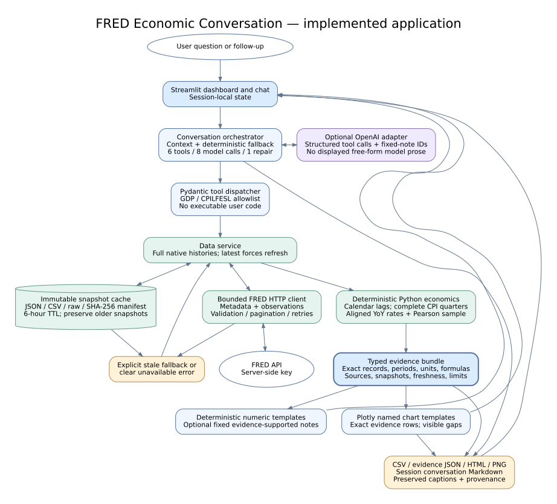

# Implemented architecture

This is one local Streamlit application at the root of [Conversational-AI-for-Economic-Data-Analysis-Recommendation-Engine](https://github.com/michaelphamtransjsu/Conversational-AI-for-Economic-Data-Analysis-Recommendation-Engine). Its entry point is [`app.py`](../app.py), with modules under `src/fred_chat/`. The supplied [implementation specification](implementation_spec.md) defines requirements; [evaluation results](evaluation_results.md) record executed checks. The specification's proposed nested directory is a design example, not the current repository layout. **DEMO / SYNTHETIC outputs are not empirical economic findings.**

The rendered SVG is generated from [Graphviz source](architecture.dot) with `dot -Tsvg docs/architecture.dot -o docs/architecture.svg`. [Mermaid source](architecture.mmd) expresses the same components and flows. Graphviz is a documentation tool, not an application runtime dependency.

## Request and evidence flow

1. `app.py` owns sidebar dates, mode, refresh, native-frequency history, comparison, cards, chat, and downloads. Streamlit session state owns the data service, conversation, tool result IDs, and bounded PNG cache. Mutable conversation objects are never globally cached.
2. `conversation.py` checks unsupported scope, resolves supported prompts and contextual follow-ups, and optionally asks the configured OpenAI adapter for structured tool requests. With no provider or a provider failure, the deterministic parser supports the documented shortcuts. Demo mode does not call FRED or OpenAI.
3. `provider.py` sends only bounded messages to a fixed HTTPS endpoint. Tool schemas come from Pydantic models. Raw model prose is discarded. A separate structured selection may choose IDs of fixed evidence-supported explanatory notes.
4. `tools.py` validates tool names, dates, series, metrics, chart types, argument size, and prior result IDs. A request selects a named Python function; it never supplies executable Python, SQL, shell, expressions, or arbitrary URLs. Each analytical tool retrieves each required series once and uses that pinned snapshot for its evidence. A chart follow-up copies prior evidence without retrieval.
5. `cache.py` serves fresh immutable snapshots or retrieves through `fred_client.py`. Native full histories are requested with `units=lin`; metadata and observations are validated. Latest/current explicitly forces retrieval. On failure a valid older snapshot may be returned only with a stale notice and its original retrieval time. No snapshot means a useful unavailable error.
6. `analytics.py` computes calendar-aware transformations before window trimming. `alignment.py` averages complete three-month CPI index quarters, computes quarterly YoY rates, and inner-joins GDP/CPI rates. `schemas.py` carries the resulting records, summary, units, formulas, defaults, limitations, and provenance.
7. `narrative.py` renders authoritative numeric templates; `charts.py` renders named Plotly templates from those exact records. `ui.py` displays evidence and produces CSV, JSON, self-contained HTML, PNG, and session Markdown downloads.

## Economic and data contracts

Only GDP and CPILFESL are enabled. GDP is nominal quarterly GDP in billions of dollars at a seasonally adjusted annual rate; CPILFESL is a monthly seasonally adjusted index, 1982–1984=100. Growth/inflation defaults to YoY; latest reported GDP defaults to its level. Native calendars are reindexed before lagging, gaps remain null, and pre-window history supplies baselines. No GDP interpolation or CPI-based substitute for real GDP is implemented.

Comparison uses `100*(G[q]/G[q-4]-1)` and `100*(Cbar[q]/Cbar[q-4]-1)`, where `Cbar` is the arithmetic mean of exactly three valid CPI index months. Pearson correlation and chart values use the same finite joined quarters. At least eight paired quarters and nonconstant rates are required. Correlation establishes neither causality nor predictive power.

Every numeric result retains its period, metric, units, requested window, formulas, source definitions, retrieval UTC time, source update field, and snapshot ID. Observation dates and source update timestamps are not represented as publication dates. FRED revisions can change later retrievals; stored snapshots reproduce retrieved values, not arbitrary historical vintages.

## Bounds, recovery, and secrets

The configured maximum is six economic tool calls per turn, eight model calls including note selection, and one invalid-tool repair. Conversation history and retained tool results are limited to thirty entries. Requests are bounded by input, message, argument, and response sizes. HTTP uses configured bounded timeouts, up to three transient attempts, and bounded Retry-After handling; a server delay beyond the wait budget returns an error instead of retrying early. Pagination has count, offset, real-time consistency, native-calendar, duplicate, and page-budget validation.

The cache default TTL is six hours. Each snapshot stores JSON, CSV, sanitized raw responses, and a manifest with SHA-256 checksums and coverage. Complete files are published atomically; the manifest is published last. Refresh preserves older snapshots. Corrupt entries are skipped with notices when another valid snapshot exists; live selection excludes demo fixtures. Snapshot write failure is disclosed while retaining fresh evidence in memory.

Keys stay in server-side environment or ignored local configuration. SecretStr masks configuration representations; provider prompts omit credentials, public errors omit raw request bodies/URLs, and FRED HTTP logging redacts credential-bearing query values. User text is treated as data. Exports preserve mode/freshness metadata and redact known credentials from conversation text.

## Verification and limits

The submission includes executed offline rubric conversations, formula/missing-period/alignment tests, mocked FRED/provider failures, cache integrity and refresh checks, Streamlit AppTest flows, and actual chart exports. See [evaluation](evaluation_results.md) for final commands and counts and [technical report](technical_report.md) for interpretation.

No live FRED or OpenAI access was validated in this build because credentials were unavailable. Synthetic histories exercise application behavior and do not establish current economic conditions. Static PNG export was tested with pinned Kaleido 0.2.1's bundled renderer after Kaleido 1.2.0 failed with the available browser; the older renderer emits deprecation warnings and needs future portability work. HTML and CSV remain independent export paths.
