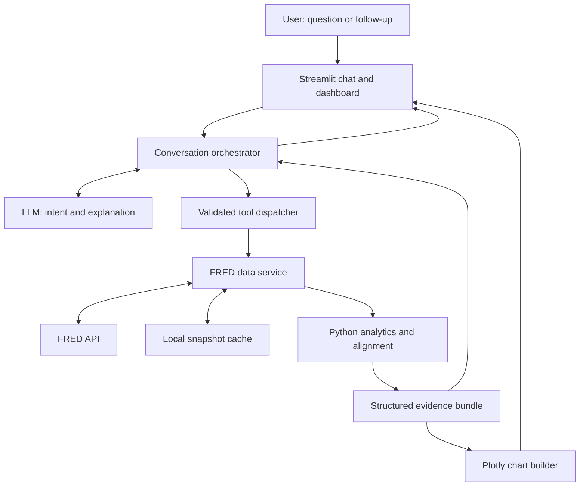

# FRED Economic Conversation App — Architecture and Codex Build Plan

Status: proposed implementation specification, not a completed application or empirical findings report.

## 1. Goal and scope

Build a conversational application that retrieves FRED GDP and CPILFESL observations, answers all seven assignment questions, computes reproducible indicators, and presents charts with sources and dates. The LLM interprets and explains; deterministic Python functions retrieve, calculate, align, and plot.

Use a single Python application with Streamlit, pandas, Plotly, Pydantic, an HTTP client, pytest, and one configurable LLM provider with structured tool calling. Pin tested dependency versions during implementation. Keep the provider and model in configuration. This is a proposed stack selected for a compact student project; a separate web API, vector database, multi-agent framework, and model training are unnecessary for the required scope.

MVP: the two required series, live retrieval, historical analysis, contextual follow-ups, validated calculations, downloadable charts/data, and submission artifacts. Optional later: real GDP (GDPC1), vintage analysis, lagged correlations, deployment authentication, and forecasting. Do not add optional series silently.

## 2. Architecture diagram



The LLM does not receive API secrets, execute arbitrary code, or fetch arbitrary URLs. Python owns the final numeric cards, tables, sources, and chart specifications. Model-generated explanations are grounded in the evidence bundle and may not introduce unsupported numerical or causal claims.

## 3. Components and responsibilities

| Component | Responsibility | Output |
|---|---|---|
| Chat UI | Prompt shortcuts, date controls, conversation, data freshness, export | Answer, evidence table, chart |
| Orchestrator | Retain session context, resolve follow-ups, call model, manage bounded tool loop | Validated request and grounded response |
| Dispatcher | Enforce allowed series, operations, date ranges, chart types | Safe Python function call |
| FRED client | Retrieve metadata and raw observations; handle pagination, timeouts, API errors | Raw data and provenance |
| Cache | Preserve retrieval snapshots and permit explicit refresh | Reproducible datasets |
| Analytics | Compute growth, inflation, summaries and aligned correlation | Typed result bundle |
| Chart builder | Render named chart templates from computed data | Plotly figure, HTML/PNG export |
| Evaluation | Formula tests, mocked API tests, conversation scenarios | Test results and requirement checklist |

## 4. Data contract and economic definitions

| Series | Meaning | Native frequency | Native units | Required interpretation |
|---|---|---|---|---|
| GDP | Nominal U.S. GDP | Quarterly | Billions of dollars, seasonally adjusted annual rate | Not inflation-adjusted GDP; annual-rate level is not the actual dollar total for that quarter |
| CPILFESL | Core consumer price index excluding food and energy | Monthly | Index, 1982–1984 = 100, seasonally adjusted | Index level is not an inflation percentage |

Keep period dates distinct from retrieval timestamps and source update timestamps. Display GDP periods as quarters and CPI periods as months. Never present the observation date as its publication date. Store source update time as metadata; retrieve release metadata separately if the UI displays an actual release date.

Core CPI percentage changes here are calculated from the required seasonally adjusted series. Label that choice; do not claim exact equivalence with every published BLS headline year-over-year figure.

### Deterministic formulas

For GDP level G at quarter q and CPI index C at month m:

- GDP year-over-year growth: `100 * (G[q] / G[q-4] - 1)`.
- GDP quarter-over-quarter growth: `100 * (G[q] / G[q-1] - 1)`.
- GDP annualized quarter-over-quarter growth: `100 * ((G[q] / G[q-1])**4 - 1)`.
- Core CPI year-over-year inflation: `100 * (C[m] / C[m-12] - 1)`.
- Core CPI month-over-month inflation: `100 * (C[m] / C[m-1] - 1)`.
- Change in a rate: subtract rates and report percentage points, not percent.
- GDP level change over an interval: report absolute change and `100 * (last / first - 1)`, naming the exact endpoints.

Default current inflation to year-over-year, state that assumption, and show month-over-month as a secondary figure. Default unspecified GDP growth to year-over-year and label it. Return an explanation if real GDP is requested: GDP is nominal; real GDP requires an additional series outside the default scope. Never deflate nominal GDP with Core CPI as a substitute for real GDP.

Reindex observations to a regular monthly or quarterly calendar before lagging. Missing dates must remain missing; a row shift must not accidentally compare different calendar intervals. Do not forward-fill missing observations. Fetch at least twelve months/four quarters of pre-window history for year-over-year calculations, compute rates first, then trim the display window. Round only for presentation.

### GDP–inflation comparison policy

Use a shared quarterly, year-over-year basis by default:

1. Compute nominal GDP YoY growth at native quarterly frequency.
2. Compute the arithmetic mean of the three monthly CPI index levels in each calendar quarter. Require all three valid months.
3. Compute quarterly Core CPI inflation as `100 * (quarterly_mean[q] / quarterly_mean[q-4] - 1)`.
4. Inner-join valid rates on calendar quarter; exclude incomplete quarters and explain the common window.
5. Plot both percentage rates on one percentage axis. Calculate Pearson correlation using only those paired observations.

This is the YoY change of quarterly-average CPI, not the average of monthly YoY rates. Show the chosen definition in the chart caption. Do not repeat quarterly GDP across months to inflate the sample size. Do not correlate raw trending levels as the primary relationship analysis.

Report correlation coefficient, paired-quarter count, start/end quarter, and method. Require at least eight paired quarters as an application policy, and reject constant or insufficient series. Describe an association within the selected window; do not infer causation or predictive power. Nominal GDP already contains price effects, and results can depend on sample period, revisions, and extreme observations.

## 5. Retrieval, freshness and provenance

Use `https://api.stlouisfed.org/fred/series` for metadata and `/fred/series/observations` for data, with a registered FRED API key, JSON format, native frequency, and untransformed units (`lin`). Allowlist GDP and CPILFESL.

Retrieve both full available histories because these datasets are small. Handle pagination even if a normal response fits one page. Parse FRED missing markers as null, sort dates, reject duplicate dates, validate metadata and finite numeric values, and preserve raw responses without secrets.

Cache full-series snapshots on disk as JSON/CSV with a manifest. Proposed TTL: six hours, plus a Refresh button. A request for latest/current attempts refresh; on failure it may use the last successful snapshot only with an explicit stale-data warning and the previous retrieval time. No snapshot means a clear data-unavailable response. Latest means the most recent valid observation returned, not today's economic state. If the newest dated row is missing, disclose that the displayed valid period is earlier.

Use bounded timeouts and up to three attempts with backoff for transient errors. Respect rate-limit retry guidance when present; do not retry invalid credentials indefinitely. Never put an API key in logs or artifact manifests. Distinguish an unavailable key, network failure, invalid response, empty range and insufficient history.

Snapshot manifest: snapshot ID, series IDs, source URLs, retrieval time in UTC, source last-updated fields, observation coverage, requested real-time parameters, and file checksums. Preserve older snapshots when refreshes occur; use one snapshot per series consistently throughout a single answer. FRED values may be revised; snapshotting reproduces what this app retrieved, not an arbitrary historical vintage. Historical-as-of questions are unsupported in MVP and must say so.

## 6. Conversational contract

Expose a small set of typed tools to the LLM:

| Tool | Arguments | Result |
|---|---|---|
| `latest_indicator` | series, metric | Latest period, value, unit, source, freshness |
| `analyze_history` | series, metric, start, end | Computed series, endpoints, extrema and descriptive trend |
| `compare_indicators` | start, end | Quarterly aligned rates and correlation |
| `build_chart` | prior result ID, allowlisted chart kind | Figure reference using that result's exact data |
| `summarize_economy` | start, end | Evidence bundle covering both series |

Use enums and date validation. Reject invented series, unsupported operations, reversed ranges and arbitrary Python/SQL requests. Internally these tools call the shared analytics service; no duplicated formulas inside prompts.

Conversation state: selected series, metric, date range, chart type and previous result ID, scoped to the user's session. For “now compare it with inflation,” retain the prior GDP window and choose the documented comparison definition. Ask clarification only when the prior context cannot resolve a materially ambiguous request. Display all applied defaults.

Bound the orchestration loop (for example, six tool calls and one schema-repair attempt). On model/provider failure, explain the limitation; the dashboard may still show deterministic data and charts. An offline fixture mode is useful for tests but must be marked DEMO and cannot be described as live/latest.

Every answer contains: direct answer; relevant observation period; metric and units; selected window and calculation basis; source links and retrieval time; relevant limitations; optional chart and data download. The structured numeric table is authoritative. Prefer fixed numeric summary templates with LLM prose around them; test that prose does not contradict returned values.

## 7. UI and visualization plan

- Top: title, brief purpose, latest GDP level and Core CPI YoY cards, each with its own observation period.
- Sidebar: date window, metric choice, refresh control, data mode/freshness. Keep credentials server-side.
- Main: chat transcript with seven rubric prompt shortcuts, answers, charts and expandable evidence.
- Exports: displayed data as CSV; interactive chart as HTML; static PNG using a tested export dependency; conversation as Markdown.

Required chart templates:

1. GDP level over ten years, billions of dollars at SAAR.
2. Monthly Core CPI YoY inflation over five years, percent.
3. Quarterly nominal GDP YoY growth and quarterly Core CPI YoY inflation, percent, shared axis.
4. Optional supporting scatter plot of the paired quarterly rates with correlation and sample size.

Each chart includes exact coverage, metric, units, source, snapshot date and transformation in its caption. Do not overlay GDP dollar levels and CPI index levels on a shared axis. Show gaps instead of inventing values.

## 8. Proposed repository layout

```text
fred-economic-chat/
  app.py
  pyproject.toml
  .env.example
  .gitignore
  README.md
  AGENTS.md
  src/fred_chat/
    config.py
    schemas.py
    fred_client.py
    cache.py
    analytics.py
    alignment.py
    charts.py
    tools.py
    conversation.py
    prompts.py
  tests/
    fixtures/
    test_analytics.py
    test_alignment.py
    test_fred_client.py
    test_tools.py
    test_conversations.py
  scripts/
    export_demo.py
    evaluate.py
  docs/
    architecture.md
    architecture.mmd
    architecture.svg
    sample_conversations.md
    technical_report.md
    evaluation_results.md
  artifacts/
    figures/
    sample_data/
    snapshot_manifest.json
```

Ignore `.env`, virtual environments, runtime caches and private logs. Include small documented, non-secret test fixtures and reproducibility snapshots deliberately. Runtime config: `FRED_API_KEY`, `LLM_API_KEY`, `LLM_MODEL`, `CACHE_TTL_SECONDS`, and `DEMO_MODE`. Document the provider selected during implementation and keep keys out of screenshots and exports.

## 9. Rubric traceability and acceptance criteria

| Assignment question | Implemented behavior | Acceptance evidence |
|---|---|---|
| Latest reported GDP | Retrieve latest valid nominal GDP level with quarter and SAAR units | Value matches selected API snapshot; source and freshness shown |
| GDP over ten years | Chart and endpoint/percentage-change summary | Exact window disclosed; calculations verified against fixture |
| Current Core CPI inflation | Latest monthly YoY rate, optional MoM | Twelve-month baseline used; index not mislabeled as percent |
| Core CPI over five years | Monthly YoY chart and numerical trend summary | Pre-window history included; extrema and endpoints reproducible |
| Relationship | Quarterly alignment, Pearson r, sample count and cautious interpretation | Three valid CPI months per quarter; same sample for chart and r |
| Comparison visualization | Shared quarterly percentage-rate chart | Legend, units, source, exact window, HTML/PNG exports |
| Key trends | Grounded summary of both datasets | Every numerical claim traceable to analytics result |

Additional acceptance: “use the last five years” and “now graph it” work as follow-ups; invalid credentials and missing data yield useful messages; no arbitrary execution; a fresh environment can start the app using README instructions.

## 10. Validation strategy

Use synthetic fixtures for formula assertions and frozen FRED responses for integration tests. Clearly label synthetic data. Meaningful cases include:

- GDP 100 → 110 one year apart gives 10% YoY; quarter 100 → 102 gives 2% QoQ and about 8.243216% annualized.
- CPI 200 → 206 twelve months apart gives 3% YoY; 205 → 206 gives about 0.487805% MoM.
- An inflation rate of 4% → 3% is a decline of one percentage point, while the price index may still rise.
- Missing calendar month, missing baseline quarter, null latest value, duplicate date and zero denominator are handled explicitly.
- Partial CPI quarter is excluded, pre-window baselines are preserved, and correlation uses precisely the plotted paired rows.
- Empty, short and constant series do not produce misleading correlation results.
- Cache hit, forced refresh, changed/revised observation, timeout, authentication error and stale fallback preserve accurate provenance.
- Schema rejection blocks invalid series and injection attempts such as requests to run shell commands.
- Multi-turn context remains session-local; unsupported real-GDP and historical-vintage requests are explained.

Run offline tests in CI. Use a separate opt-in live smoke test with secrets to verify retrieval; never assert a hard-coded current GDP or CPI value. Evaluate all seven rubric questions against a fixed snapshot, then run them live for the final demo. Record actual pass/fail results, model/configuration, sample period and snapshot IDs. Do not claim tests or live calls succeeded unless executed.

## 11. Implementation phases for Codex

| Phase | Work | Exit gate |
|---|---|---|
| 1: Foundation | Repository, config, schemas, dependencies, setup docs | App starts; missing keys produce clear configuration message |
| 2: Data | FRED metadata/observations, snapshots, validation, refresh | Mocked failure tests pass; live smoke test recorded when keys available |
| 3: Economics | Formula functions, calendar lags, comparison alignment | Formula and edge-case tests pass independently of the LLM |
| 4: Dashboard | KPI cards, chart templates, evidence, exports | Correct labels; charts inspectable; CSV/HTML/PNG export works |
| 5: Conversation | Provider adapter, typed tools, context, bounded loop | Seven prompt scenarios and follow-ups work; errors are clear |
| 6: Submission | Run demo/evaluation, capture conversations, findings report and architecture export | Deliverable checklist complete with reproducible evidence |

Build and verify each phase before expanding scope. If API keys are unavailable, finish the offline implementation and explicitly list the remaining live checks. Do not turn fixture-based output into purported economic findings.

## 12. Submission package

- Working application and README with installation, environment variables, startup command, design choices, limitations and demo instructions.
- Source code, pinned dependencies and meaningful tests.
- Architecture diagram source plus rendered SVG/PNG.
- Actual sample conversations covering all seven questions, at least two follow-ups, and one failure case; record dates and configuration.
- Three required exported economic charts with source captions and accompanying CSVs.
- Brief technical report, suggested length 3–5 pages unless the instructor specifies otherwise: objective; data definitions; architecture; formulas/alignment; evaluated results and actual economic findings; limitations; references.
- Evaluation results and snapshot manifest. A README can link these artifacts; keep the report separately identifiable so submission completeness is easy to verify.

## 13. Paste-ready Codex implementation prompt

> Implement the FRED conversational economic analysis application described in this architecture plan. Treat this file as the implementation specification and create AGENTS.md with its non-negotiable economic and evidence rules. First inspect the repository and existing instructions, then implement the six phases in order. Use Python, Streamlit, pandas, Plotly, Pydantic, a FRED HTTP client and one configurable LLM provider supporting structured tool calls. Keep the implementation modular but within one application.
>
> Support only GDP and CPILFESL by default. GDP is nominal, quarterly, billions of dollars at a seasonally adjusted annual rate; CPILFESL is a monthly seasonally adjusted price index. Implement all calculations in deterministic Python. Default GDP growth and Core CPI inflation to YoY. For comparison, calculate YoY growth of quarterly GDP and YoY change of complete quarterly-average CPI, then inner-join valid quarters. Never interpolate GDP to monthly data or infer causality from correlation. Preserve dates, units, formulas and source provenance in every result.
>
> Implement validated tools, contextual follow-ups, bounded orchestration, clear error handling, secret-safe configuration, snapshot caching and refresh, explicit stale-data notices, and chart/data exports. Never generate arbitrary executable code from user prompts. Use deterministic numeric tables/templates and ground LLM explanations in tool evidence.
>
> Add meaningful formula, missing-period, alignment, API-failure, cache and conversation tests. Run tests and fix failures. Verify all seven rubric questions and follow-ups. Produce README, architecture source and rendered diagram, actual sample conversations, economic chart exports, a brief technical report, evaluation results and snapshot metadata. Do not invent empirical findings, successful tests or live API access. If credentials are unavailable, complete offline work with explicitly labeled fixtures and list the exact live validations still needed.
>
> Work through reversible implementation steps without routine confirmation. Do not expose or commit secrets. Do not push, merge, deploy publicly, or incur unrelated service charges without separate authorization. Finish with files changed, commands run, actual test results, startup steps and remaining blockers.

## 14. Official references

- FRED GDP series and metadata: https://fred.stlouisfed.org/series/GDP
- FRED Core CPI series and metadata: https://fred.stlouisfed.org/series/CPILFESL
- FRED observations API: https://fred.stlouisfed.org/docs/api/fred/series_observations.html
- FRED series metadata API: https://fred.stlouisfed.org/docs/api/fred/series.html

The series definitions and API interfaces were checked against the official pages while preparing this plan. The default metrics, comparison procedure, cache policy and architecture are explicit project design decisions. No current numerical economic findings are asserted in this plan.
